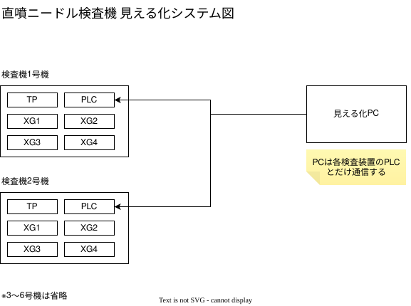

# 直噴ニードル検査機 見える化 Step1仕様
最終更新: 2026/11/20

## 目的&機能
- 前工程(NC加工、放電加工)に対して検査装置のNG情報をリアルタイムにフィードバックする。
- 前工程が問題にすぐに気づくことができ、問題の早期解消を狙う。

## 基礎仕様
- 同一工場の前工程(NC工程)に検査機の検査結果(NG数情報)をリアルタイムに通知する
- 通知内容はタッチパネルのST別のNG情報のみ(つまりPLCが持っている情報のみ)
- 画像処理の検査項目別のNG数は除外(別項にて検討する)
- 前工程にはノートPCを設置し、大型モニタを接続する
- タッチパネルでNCと放電の加工日と機番を入力する


## 機器の準備
### 京和準備
- 前工程設置ノートPC
### コバテック様準備
- 大型モニタ&モニタスタンド
- Bluetoothキーボード&マウス&キーボード台
- LANケーブル&HUB


## ネットワーク構成
```TEXT
ニードル検査機No.1
    PLC (192.168.8.1)
    タッチパネル (192.168.8.2)
    XG1 (192.168.8.3)
    ...

ニードル検査機No.2
    PLC (192.168.8.11)
    タッチパネル (192.168.8.12)
    XG1 (192.168.8.13)
    ...
...
...

ニードル検査機No.2
    PLC (192.168.8.11)
    タッチパネル (192.168.8.12)
    XG1 (192.168.8.13)
    ...

前工程設置PC (192.168.8.101)
```



## PC表示画面構想
(SVGデータにて作成予定...)


## 開発スケジュール

| 予定日 | 作業内容 | 備考 |
| ---:|---|---|
| 2026/11/27 | 見積提出 | |
| 12/1 | 正式受注・制作開始 | |
| 12/5 | ネットワーク構成変更 | IPアドレス変更 |
| 12/10 | 機器接続 | LANケーブル・HUB接続（コバテック様実施） |
| 12/15 | 現地通信確認・テキストデータ表示 | |
| 12/20 | グラフ化 | |
| 12/24 | 運用開始 | バグ抜き・微修正 |
| **2027/1/6** | **本格稼働** | |


## 第2ステップ以降の構想
(検討中...)
